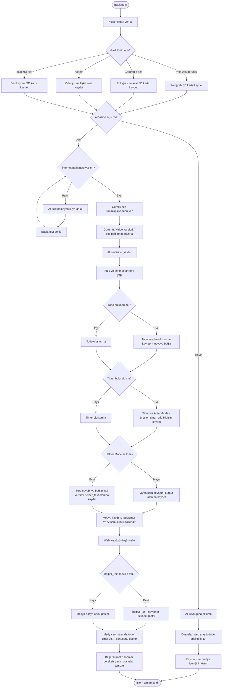

# HANDY Overview  

XIAO Sense — Akıllı Ses, Görüntü ve Erişilebilirlik Asistanı
Bu proje, Seeed Studio XIAO ESP32-S3 Sense kartı üzerinde çalışan; fotoğraf, video ve ses kayıtlarını SD karta kaydeden, isteğe bağlı olarak yapay zekâ ile analiz eden ve sonuçları yerel web arayüzünde sunan bir yardımcı sistemdir.

Sistem iki temel ilkeye göre tasarlanmıştır:
- AI Vision kullanıcının açık kontrolündedir. Varsayılan olarak kapalıdır. Kapalıyken kayıtlar SD karta kaydedilir; Wi-Fi bağlantısı olsa bile AI servislerine gönderilmez.
- Helper Mode, normal görev işleyişinin yerine geçmez. Todo ve zamanlayıcı çıkarımı her iki modda da sürer. Helper Mode açıkken bunlara ek olarak bağlamsal açıklama ve erişilebilir yardım metni üretilir.
Bu README, v12.6 için belirlenen çalışma davranışını açıklar. Donanım üzerinde doğrulanmamış özellikler kesin çalışıyor kabul edilmemelidir; derleme ve kart testleri ayrıca yapılmalıdır.

1. Donanım ve yazılım
- Kart: Seeed Studio XIAO ESP32-S3 Sense
- Kamera, mikrofon ve microSD depolama
- Arduino IDE
- ESP32 Arduino Core 3.3.x
- ArduinoJson 7.x
- İnternet erişimi gerektiren AI işlemleri için yapılandırılmış API anahtarı
Arduino IDE ayarları
Önceki kart yapılandırmasında kullanılan ayarlar:
- Kart: XIAO ESP32S3
- PSRAM: OPI PSRAM etkin
- Flash: 8 MB
- CPU: 240 MHz
- USB CDC On Boot: Enabled
- Upload Speed: 115200
- Serial Monitor: 115200 baud
Projeyi derlemeden önce gerekli kart paketinin ve ArduinoJson kütüphanesinin kurulu olduğundan emin olun.
2. Varsayılan ayarlar
Ayar	İlk değer	İşlev
AI Vision	Kapalı	Fotoğraf/video ve ilişkili kayıtların AI analizine gönderilmesini kontrol eder
Helper Mode	Açık	Analiz sonucuna ek olarak helper_text üretimini etkinleştirir
Fotoğraf/video ile ses kaydı	Ayara bağlı	Fotoğraf veya video ile ilişkili ses kaydı davranışını kontrol eder

AI Vision kapalıyken
1. Fotoğraf, video ve ses kayıtları normal şekilde SD karta yazılır.
2. Kayıtlar AI analiz kuyruğuna gönderilmez.
3. Cihazın Wi-Fi bağlantısı olması bu kuralı değiştirmez.
4. Kayıtlar web arayüzünden görüntülenebilir veya indirilebilir.
5. AI Vision daha sonra açıldığında, daha önce yerel olarak bırakılmış eski kayıtlar kendiliğinden geriye dönük gönderilmez.
AI Vision açıkken
Yeni kayıtlar, internet bağlantısı ve geçerli API yapılandırması mevcutsa AI işleme kuyruğuna alınabilir. Wi-Fi yoksa işleme, bağlantı sağlanana kadar bekleyebilir.
3. Girdi türleri
Sistem dört temel girdi biçimini işler:
1. Yalnızca görüntü: Fotoğraf.
2. Görüntü + ses: Fotoğrafla ilişkilendirilmiş ses kaydı.
3. Video: Video kaydı; analiz için videodan örnek kareler ve varsa ilişkili sesin transkripti kullanılır.
4. Yalnızca ses: Bağımsız ses kaydı.
Bir fotoğraf veya video ile sesin ilişkilendirilmesi, kayıt zamanları ve proje ayarlarına göre yapılır.
4. AI çıktı mantığı
Todo ve timer çıkarımı Helper Mode'dan bağımsızdır. Her iki modda da AI, kullanıcının girdisinden görev ve zamanlayıcı talebi çıkarmaya çalışır.
4.1 Helper Mode kapalı — Normal mod
Bu modda üretilebilecek alanlar:
Alan	Açıklama
todo	Kullanıcının yapılmasını istediği görevler
timer	Zamanlayıcı için saniye cinsinden süre
timer_title	AI tarafından üretilen zamanlayıcı adı
output	Todo ve timer dışında kullanıcının sorduğu soruya verilen cevap

Örnek: Kullanıcı bir fotoğraf gönderip “Bu bina hangi döneme ait?” diye sorarsa cevap output alanında döner. Aynı girdide bir görev de belirtmişse todo da oluşturulur.

Örnek çıktı:
{
  "todo": [
    "Akşam müzeye git"
  ],
  "timer": [],
  "output": "Fotoğraftaki yapı ..."
}
Zamanlayıcı varsa:
timer:1800sn
timer_title:Calculus çalışma süresi
Herhangi bir görev, zamanlayıcı veya soru cevabı yoksa ilgili alan üretilmemelidir. Olmayan görev veya zamanlayıcı uydurulmamalıdır.
4.2 Helper Mode açık — Genişletilmiş mod
Bu modda normal moddaki todo ve timer işlevleri aynen devam eder. Bunlara ek olarak helper_text üretilir.
Alan	Açıklama
todo	Kullanıcının yapılmasını istediği görevler
timer	Zamanlayıcı için saniye cinsinden süre
timer_title	AI tarafından üretilen zamanlayıcı adı
helper_text	Soruların cevapları, görsel/işitsel betimlemeler, çevre bilgileri ve istenen yön tarifleri

Helper Mode açıkken output yerine helper_text kullanılır. Aynı cevabın iki ayrı alanda tekrar edilmesi beklenmez.

Örnek çıktı:
{
  "todo": [
    "Akşam müzeye git"
  ],
  "timer": [],
  "helper_text": "Videodaki çevreyi ve kullanıcının sorusunu birlikte değerlendirerek verilen açıklama..."
}
Zamanlayıcı da istenmişse aynı sonuçta timer ve timer_title da bulunabilir:
todo:
Akşam müzeye git
timer:1800sn
timer_title:Müzeye gitmeden önce hazırlanma
helper_text:Bulunduğunuz noktadan tarihi meydana ulaşmak için ...
4.3 Aynı girdiden birden fazla sonuç
Tek bir video veya ses+görüntü girdisi aynı anda birden fazla çıktı üretebilir.

Örnek kullanıcı isteği:
- “Akşam müzeye gitmeyi unutma.”
- “Şu anda bulunduğumuz yerden tarihi meydana gitmek istiyoruz. Nasıl gidebiliriz?”
Beklenen davranış:
- todo: “Akşam müzeye git”
- timer: Yalnızca bir zamanlayıcı talebi varsa üretilir.
- timer_title: Zamanlayıcı varsa AI tarafından adlandırılır.
- Helper Mode açıksa helper_text: Görsel ve ses bağlamını birlikte değerlendirerek soruya cevap verir.
Yol tarifi yalnızca girdideki konum ve çevre bilgileri yeterliyse verilmelidir. Başlangıç veya hedef konumu belirlenemiyorsa bu belirsizlik açıkça belirtilmeli; güzergâh uydurulmamalıdır.
4.4 Helper Mode'un amacı
Helper Mode yalnızca görüntüyü betimlemek için kullanılmaz. Kullanıcının isteğini, sesini, görüntüsünü ve bağlamını birlikte değerlendirir. Özellikle görme ile ilgili yardımlarda açık, dikkatli, hassas ve erişilebilir açıklamalar üretmeye çalışır.

Örnekler:
- Yalnızca şelale fotoğrafı: Şelaleyi ve görülebilen çevreyi betimler. Yer kimliği güvenilir biçimde belirlenebiliyorsa tarihçesini de aktarabilir.
- Fotoğraf + ses: Görüntüyü, kişinin nerede olduğunu veya ne istediğini anlattığı sesle birlikte yorumlar.
- Video + ses: Videodaki örnek kareleri ve ses transkriptini birlikte değerlendirir; istenirse yön tarifi verir ve aynı anda todo/timer çıkarır.
- Yalnızca ses: Konuşmayı işler; görev, zamanlayıcı ve soru-cevap çıktısı üretir.
AI, emin olmadığı nesne, yer veya yön bilgilerini kesinmiş gibi sunmamalıdır.
5. Sistem çalışma akışı
Aşağıdaki şema, girdinin alınmasından web arayüzünde gösterilmesine kadar olan ana kararları gösterir. Elmas biçimli karar noktalarında Evet/Hayır dalları kullanılmıştır.

Akışla ilgili önemli kurallar
- AI Vision kapalıysa internet bağlantısı kontrol edilerek AI gönderimi yapılmaz; doğrudan yerel saklama akışı izlenir.
- Helper Mode kapalı olması todo ve timer çıkarımını kapatmaz.
- Todo bulunmaması, todo alanına yapay bir görev yazılacağı anlamına gelmez.
- Timer yoksa timer kaydı oluşturulmaz.
- Helper Mode açıkken helper_text sayfanın en üstünde gösterilir.
- helper_text yoksa ilgili medya için dosya adı gösterilir.
- Her todo, geldiği fotoğraf/ses/video kaynağıyla ilişkilendirilir.
- Geçici analiz dosyaları, ilgili analiz başarıyla tamamlandıktan sonra temizlenir. Orijinal medya ve kullanıcı verileri korunur.
6. Fiziksel butonlar
Butonlar aktif-düşük mantığıyla çalışır; butonun bir ucu GPIO pinine, diğer ucu GND'ye bağlanır.
Fiziksel buton	Hareket	İşlem
1. tuş — D0 / GPIO1	Çift tık	Fotoğraf çek
1. tuş — D0 / GPIO1	Tek tık	Video kaydını başlat
1. tuş — D0 / GPIO1	Video kaydı sürerken tek tık	Video kaydını bitir
2. tuş — D1 / GPIO2	Basılı tut	Basılı tutulduğu sürece ses kaydet
2. tuş — D1 / GPIO2	Bırak	Ses kaydını bitir ve kaydet

İlk butonda tek tık ile çift tık ayrımı için kısa bir bekleme penceresi kullanılır. Bu nedenle fotoğraf çekimi çift tıklamayla, video başlatma/durdurma ise tek tıklamayla yapılır.
7. Web arayüzü kontrolleri
- Fotoğraf ve video için tek bir birleşik kontrol bulunur.
- Kısa basıp bırakma fotoğraf çeker.
- Basılı tutma eşiği aşıldığında video kaydı başlar.
- Video kaydı sırasında buton bırakıldığında video durdurulur.
- Fotoğraf/video kontrolünün altındaki ses kaydı butonu ayrı ve sabit kalır.
- Ses kaydı butonunun mevcut başlat/durdur davranışı korunur.
Web tarayıcısının basılı tutma olayını desteklemesi gerekir. Mobil tarayıcıda sayfa kaydırma veya dokunma hareketleri buton etkileşimini kesmemelidir.
8. Web arayüzünde medya ve AI sonuçları
Helper Mode açıkken en güncel helper_text, ana sayfanın en üstünde gösterilir. Ekran okuyucuların okuyabilmesi için metin normal HTML metni olarak sunulur. Metnin yanında tarayıcının yerleşik metin seslendirme özelliğini kullanan bir oynat/dinle kontrolü bulunabilir.

Bir medya kaydı büyütüldüğünde o kayda ait bilgiler birlikte gösterilir:
- Fotoğraf/video/ses dosyası
- Varsa helper_text veya output
- O medyadan çıkarılan todo kayıtları
- O medyadan çıkarılan timer kayıtları
Todo kaydı kaynak medya dosyasına bağlanır. Kullanıcı todo kaynağına dokunduğunda ilgili fotoğraf, video veya ses kaydını açabilir.
9. Video analizinin sınırları
Video analizi, MP4 dosyasının tamamını kesintisiz biçimde bir video modeliyle analiz etmek anlamına gelmez. Firmware, videodan belirli zamanlarda JPEG kareler çıkarır. Bu kareler ve varsa ilişkili sesin transkripti AI'ya birlikte gönderilir.

Bu nedenle:
- Örnek kareler arasında gerçekleşen kısa olaylar kaçırılabilir.
- Video içindeki hareketin tüm ayrıntıları garanti edilemez.
- Ses transkripti, görüntü bağlamını tamamlamak için kullanılabilir.
- AI, yalnızca örnek karelerden göremediği ayrıntıları görmüş gibi anlatmamalıdır.
MP4 kayıtları Motion-JPEG biçimindedir. Oynatma uyumluluğu kullanılan tarayıcıya ve medya oynatıcıya göre değişebilir.
10. Todo ve timer kayıtları
Todo
- Todo kayıtları SD kartta kalıcı olarak saklanır.
- Tamamlanan todo işaretlenebilir.
- Todo metni tamamlandığında üzeri çizili gösterilir.
- Todo kaydının kaynak medya dosyası saklanır.
- Silme/geri alma davranışı web arayüzünde uygulanır.
Timer
AI, zamanlayıcı süresini ve adını birlikte üretir:
timer:1800sn
timer_title:Calculus çalışma süresi
- timer: saniye cinsinden süre.
- timer_title: AI tarafından üretilen kısa ve anlaşılır zamanlayıcı adı.
Timer yoksa timer kaydı oluşturulmaz. Timer süresi ve başlığı aynı timer kaydında saklanmalıdır.
11. Boş ses kaydı kontrolü
Ses kaydı sırasında örneklerin RMS (ortalama enerji) ve peak (tepe genliği) değerleri ölçülerek çok düşük sinyal olasılığı kontrol edilir.

Kayıt boş veya sessiz göründüğünde otomatik silinmez. Web arayüzünde kullanıcıya kaydı silmek isteyip istemediği sorulur:
- Kaydı sil
- Kaydı sakla
Bu kontrol bir sessizlik sezgisidir; mikrofon kazancı ve ortam gürültüsüne göre eşiklerin ayarlanması gerekebilir. Düşük sesli konuşma yanlışlıkla sessiz olarak sınıflandırılabileceği için otomatik silme yapılmamalıdır.
12. Wi-Fi, yerel erişim ve API ayarları
İlk kurulumda cihazın erişim noktası kullanılabilir:
- Ağ adı: XIAO-Sense-Setup
- Parola: xiao12345
- Ayarlar sayfası: http://192.168.4.1/settings
Ayarlar sayfasından internet Wi-Fi ağları ve desteklenen AI servislerinin API anahtarları yapılandırılır.

API anahtarları ve Wi-Fi bilgileri SD karttaki ayar dosyasında saklanabilir. SD kartı fiziksel olarak koruyun; kartı başkasına verirken kimlik bilgilerini içeren dosyaları silin.

API kullanımı ChatGPT aboneliğinden ayrıdır. API sağlayıcısında ayrıca etkin ve yeterli bakiyeye sahip bir hesap gerekir.
13. SD kartta kullanılan dosyalar
Başlıca dosya türleri:
Dosya	İçerik
/settings.json	Wi-Fi, API ve cihaz ayarları
/todo.json	Todo kayıtları ve tamamlanma durumları
/todo.txt	Todo listesinin okunabilir metin kopyası
/timers.json	Zamanlayıcı kayıtları
/IMG_*.jpg	Fotoğraflar
/VID_*.mp4	Video kayıtları
/REC_*.wav	Ses kayıtları
*.transcript.txt	Ses transkripsiyonu
*.summary.txt / medya sonuç dosyaları	İlgili AI analiz çıktıları
/VID_*_frame*.jpg	Video analizinde kullanılan geçici/örnek kareler

Dosya adları ve ek dosyalar firmware sürümüne göre farklılık gösterebilir. Başarılı analizden sonra yalnızca tekrar kullanılmayacak geçici dosyalar silinmelidir; orijinal medya, todo, timer ve AI sonuçları korunmalıdır.
14. Seri port komutları
Seri port, cihaz uyanıkken ve USB CDC bağlantısı etkin durumdayken kullanılabilir. Deep Sleep sırasında USB Serial komutları dinlenemez.

Desteklenen komutlar firmware sürümüne göre değişebilir. Seri portta HELP komutu ile cihazın sunduğu komut listesi kontrol edilmelidir.
15. Güç ve kamera davranışı
Kamera kullanılmadığında sürekli kare istenmemelidir. Fotoğraf/video işi başlarken kamera başlatılır; işlem tamamlandığında açık medya dosyaları sonlandırılır ve kamera sürücüsü kapatılır.

cam_hal: FB-OVF mesajı görülürse bunun mutlaka tek bir yazılım hatasından kaynaklandığı varsayılmamalıdır. Kamera bağlantısı, güç beslemesi, sürücü ve ESP32 Arduino Core uyumluluğu birlikte incelenmelidir.

Deep Sleep ayrıca etkinleştirilmişse fiziksel butonların RTC uyandırma kabiliyeti ve USB Serial'in uyku sırasında çalışmayacağı dikkate alınmalıdır. Wi-Fi ve web sunucusu Deep Sleep sırasında erişilebilir değildir.
16. Kurulum ve test sırası
1. SD kartın yedeğini alın.
2. Arduino IDE'de proje dosyasını açın.
3. Kart ve PSRAM ayarlarını kontrol edin.
4. Derleme işlemini (Verify) çalıştırın.
5. Derleme başarılıysa firmware'i karta yükleyin.
6. Serial Monitor'u 115200 baud ile açın.
7. İlk olarak AI Vision kapalıyken fotoğraf, video ve ses kayıtlarının yerel saklandığını doğrulayın.
8. AI Vision'ı açıp internet bağlantısı ve API ayarlarını doğrulayın.
9. Helper Mode açıkken aynı girdiden todo/timer ile helper_text çıktılarının birlikte oluştuğunu test edin.
10. Helper Mode kapalıyken todo/timer ile output davranışını test edin.
11. Todo kaynağına dokunulduğunda doğru medyanın açıldığını doğrulayın.
12. Kamera kapatma, geçici dosya temizliği ve boş ses kaydı uyarısını kontrol edin.
17. Doğrulama durumu ve bilinen sınırlar
Kaynak kodun statik kontrollerinin yapılmış olması, Arduino IDE'de başarılı derlendiği veya fiziksel kartta bütün özelliklerin doğrulandığı anlamına gelmez. Gerçek derleme ve donanım testleri yapılmadan sürümün tamamen çalıştığı garanti edilemez.

Özellikle aşağıdaki noktalar gerçek cihazda test edilmelidir:
- Fiziksel D0 tek/çift tıklama ayrımı
- Fiziksel D1 basılı tutma ve bırakma davranışı
- Web arayüzünde kısa basış/uzun basış ayrımı
- AI Vision kapalıyken hiçbir AI yüklemesi yapılmaması
- Helper Mode açıkken todo, timer ve helper_text çıktılarının birlikte saklanması
- Video örnek karelerinin ve ilişkili ses transkriptinin doğru medyaya bağlanması
- Kamera sürücüsünün iş bitiminde kapatılması
- SD kartta yalnızca gereksiz geçici dosyaların temizlenmesi
Önceki çalışan sürümü ve SD kart yedeğini, yeni sürümün donanım testleri tamamlanana kadar saklayın.
